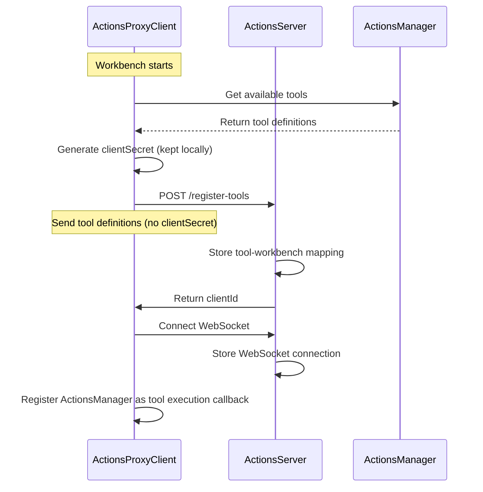

# Actions Server

## Overview

The Actions Server enables MCP clients (LLM agents) to execute tools that run in browser-based workbenches. It provides a WebSocket-based proxy system that routes tool execution requests from MCP clients to the appropriate workbench instance while maintaining security and isolation.

## Core Components

### 1. Actions Server

- Provides WebSocket endpoint for workbench connections
- Manages workbench registrations and tool mappings
- Routes tool execution requests from MCP clients to workbenches
- Exposes registered tools to MCP clients
- Supports dynamic tool registration via HTTP endpoints

### 2. ActionsProxyClient (Workbench)

- Client-side component that connects to Actions Server
- Generates and manages client secrets
- Handles WebSocket communication
- Validates and executes tool requests
- Manages tool registration and dynamic tool updates

### 3. ActionsManager (Workbench)

- Singleton manager for all actions and MCP servers
- Central entry point for tool discovery and execution
- Manages MCP server registrations
- Executes tools within the workbench sandbox
- Propagates tool registrations to the Actions Server

### 4. WorkbenchToolsMcpServer

- Provides a standardized MCP interface for workbench tools
- Connects to ActionsProxy to expose registered tools via MCP protocol
- Forwards tool execution requests from MCP clients to ActionsProxy
- Supports streaming responses for long-running tools
- Enables LLM agents to discover and use workbench tools via MCP

## System Flow

### 1. Initial Workbench Registration



### 2. Dynamic Tool Registration

```mermaid
sequenceDiagram
   participant WB as Workbench
   participant Manager as ActionsManager
   participant Client as ActionsProxyClient
   participant Server as ActionsServer

   Note over WB: New client side tool registered
   WB->>Manager: registerServer(mcpServer)
   Manager->>Manager: Store server reference
   Manager->>Manager: Invalidate tools cache
   Manager->>Manager: Get updated tools list
   Manager->>Client: addTools(clientId, updatedTools)
   Client->>Server: POST /add-tools?clientId=...
   Server->>Server: Register new tools
   Server->>Server: Update MCP tool definitions
   Note over Server: Tools now available to MCP clients
````

### 3. MCP Client Tool Execution via WorkbenchToolsMcpServer

```mermaid
sequenceDiagram
   participant User
   participant Agent as MCP Client (LLM Agent)
   participant MCP as WorkbenchToolsMcpServer
   participant Proxy as ActionsProxy
   participant Workbench as ActionsProxyClient

   Note over User: Provides clientId/clientSecret to Agent
   Agent->>MCP: Connect via MCP protocol
   MCP->>Proxy: Query for registered tools
   Proxy-->>MCP: Return all tools with clientIds
   MCP-->>Agent: Expose available tools (with clientId/clientSecret params)

   Agent->>MCP: Execute tool with clientId & clientSecret
   MCP->>Proxy: Forward tool execution request
   Proxy->>Workbench: Forward via WebSocket
   Workbench->>Workbench: Validate clientSecret
   Workbench->>Workbench: Execute tool in sandbox
   Workbench-->>Proxy: Return result (possibly streaming)
   Proxy-->>MCP: Forward result
   MCP-->>Agent: Return result (with streaming support)
```

## Security Implementation

### Workbench Authentication

- Each workbench generates a unique clientSecret using UUID (kept locally in the workbench)
- The clientSecret is never sent to the server during registration
- The clientSecret is communicated to the user (outside the system) who provides it to the LLM agent
- ClientSecret is validated by the workbench on every tool execution request
- WebSocket connections require valid clientId
- Tool requests include both clientId and clientSecret

### Message Protocol

#### Tool Request (MCP to Server)

```typescript
interface ToolRequestMessage {
 type: "TOOL_REQUEST";
 payload: {
   toolName: string;
   parameters: {
     clientId: string;
     clientSecret: string;
     [key: string]: unknown;
   };
   requestId: string;
 };
}
```

#### Tool Response (Server to MCP)

```typescript
interface ToolResponseMessage {
 type: "TOOL_RESPONSE";
 payload: {
   requestId: string;
   result: CallToolResult;
   error?: string;
 };
}
```

## Implementation Example

### 1. Server Setup

```typescript
const server = new ActionsServer({
 port: 3000,
 mcpOptions: {
   // MCP server configuration
 }
});

await server.start();
```

### 2. Workbench Integration

```typescript
// Initialize ActionsManager
const actionsManager = ActionsManager.getInstance();
await actionsManager.initialize();

// Create and configure ActionsProxyClient
const client = new ActionsProxyClient(
 "http://localhost:3000",
 "ws://localhost:3000",
 async (toolName: string, params: Record<string, unknown>) => {
   // Handle tool execution in workbench sandbox
   return { success: true };
 }
);

// Register initial tools and connect
const initialTools = await actionsManager.getAvailableTools();
const clientId = await client.registerTools(initialTools);
await client.connectWebSocket(clientId);

// Set up ActionsManager with the client
actionsManager.setActionsProxyClient(client);

// Later, when new MCP servers are registered
const newServer = new CustomMcpServer();
await actionsManager.registerServer(newServer, "custom-server");
// Tools are automatically propagated to Actions Server
```

### 4. MCP Client Usage

```typescript
// Connect to WorkbenchToolsMcpServer via MCP
const mcpClient = new McpClient({
 baseUrl: "http://localhost:9101/mcp/:clientid"
});

// Get available tools
const tools = await mcpClient.listTools();

// Execute a tool (clientId and clientSecret provided by user)
const result = await mcpClient.callTool({
 name: "writeFile",
 arguments: {
   clientId: "workbench-id",      // Provided by user
   clientSecret: "workbench-secret", // Provided by user
   path: "/example.txt",
   content: "Hello World"
 }
});
```

## Error Handling

- Invalid client credentials result in immediate rejection
- WebSocket connection failures trigger reconnection attempts
- Tool execution errors are properly propagated
- Connection status is monitored and reported